# 👗 Kastelli

<p align="center">
  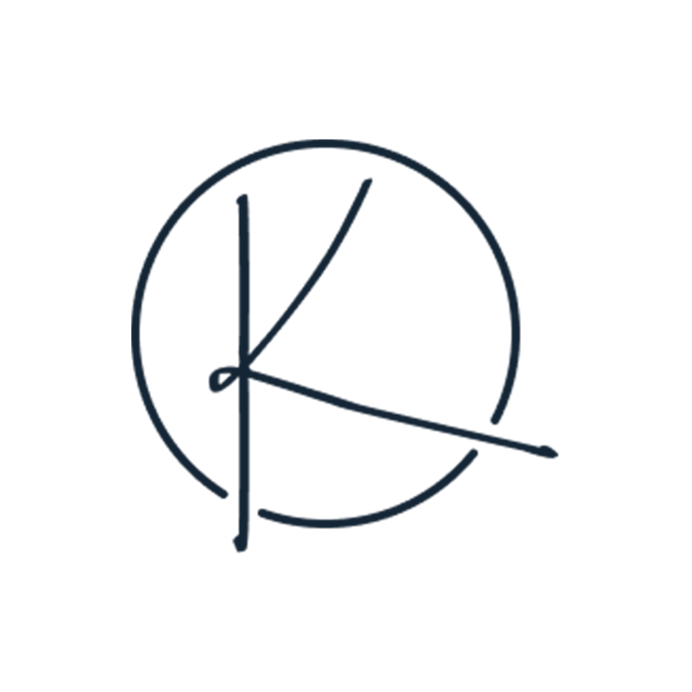
</p>

<p align="center">
  
  
  
  
  
</p>

**Kastelli** is a women's dresses e-commerce mobile app built with Flutter, connected to a real REST API.
The project focuses on a clean feature-first structure, predictable state management with **Provider**, and a smooth shopping experience.

---

## ✨ Overview

Kastelli lets users browse dresses by category, search products, view full product details with sizes and colors, and manage a persistent cart and wishlist.
The UI is built from a Figma design, and all product data comes from a live backend API.

---

## 🚀 Key Features

- 🔐 **Authentication**: sign in, sign up (name, email, phone, date of birth), server-side logout, secure token storage
- 🚪 **Smart startup**: splash screen routes to Home when a token exists; onboarding is shown only once
- 🏠 **Home dashboard**: banner carousel from the API with branded local fallback images, promo image, and featured products
- 🧭 **Categories**: Dresses, Sale, Most Popular and Eid Collection from the side drawer
- ♾️ **Infinite scroll**: products load page by page while scrolling, with retry on failure
- ↕️ **Server-side sorting**: Best match, Price (low → high / high → low) and Newest, kept correct across all pages
- 🔎 **Search**: debounced search (500 ms) with pagination, protection against outdated responses, and state preserved between tabs
- 📦 **Product details**: image carousel, sizes with availability, color swatches, quantity, expandable description
- 🛒 **Cart**: saved with SQLite, one row per product + size, quantity controls (minimum 1), swipe-to-delete with confirmation, live item count in every app bar
- ❤️ **Wishlist**: saved with SQLite, instant (optimistic) toggling
- 👤 **Profile**: user name and email, profile photo from camera or gallery, sign-out dialog
- 🖼️ **Full product images**: image boxes use the photos' 2:3 ratio, so models are shown head to toe with no cropping

---

## 📸 Screenshots

### 🚀 Splash & Onboarding
<p align="center">
  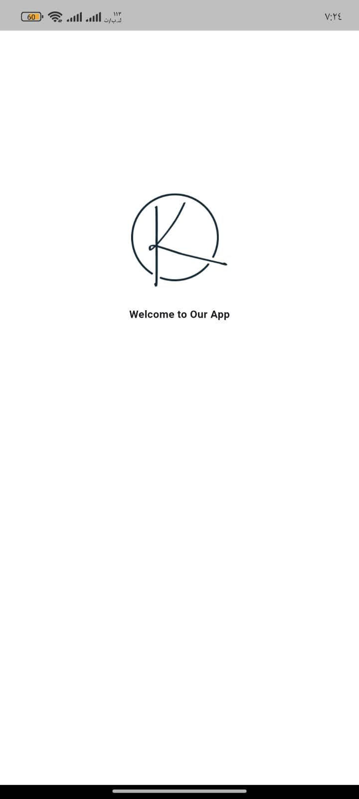
  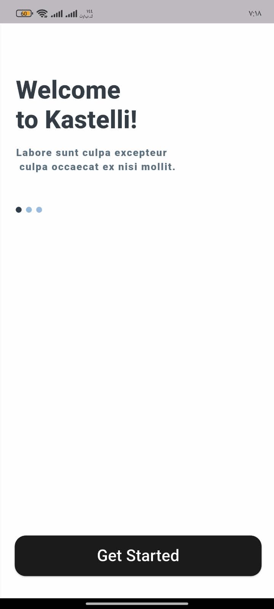
  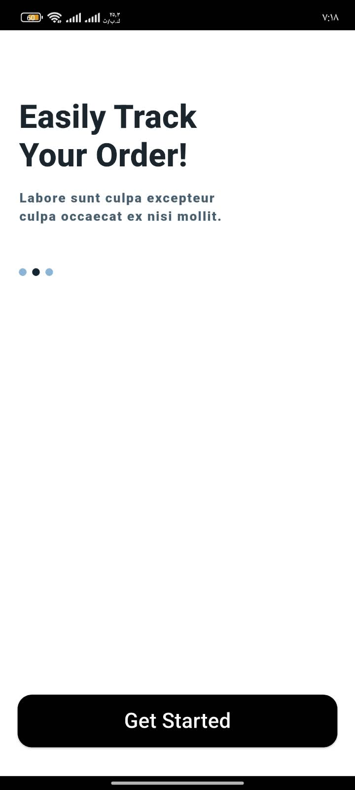
  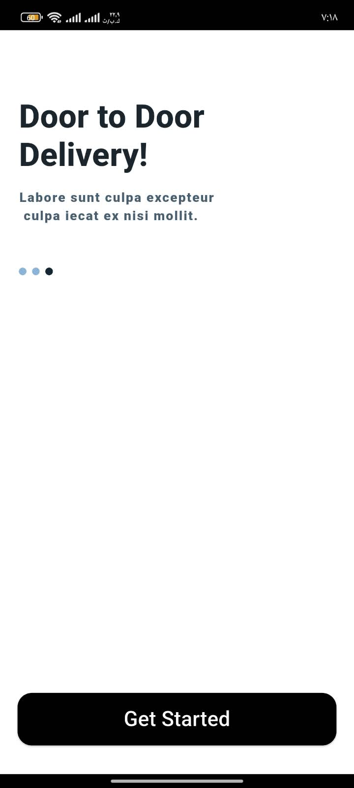
</p>

### 🔐 Authentication
<p align="center">
  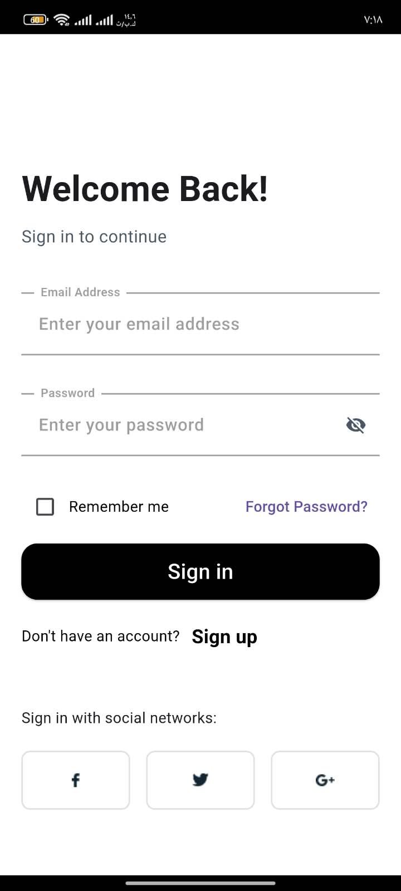
  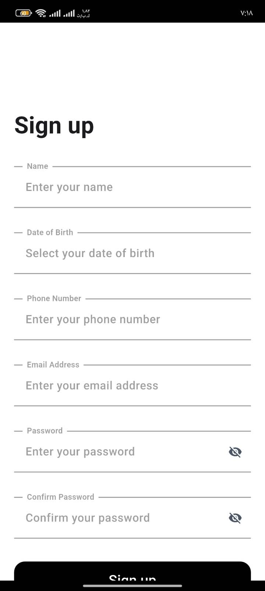
</p>

### 🏠 Home
<p align="center">
  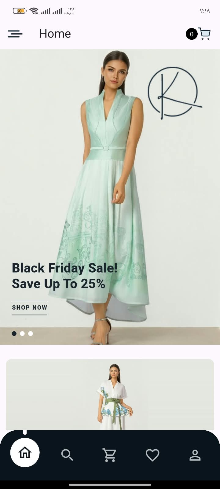
  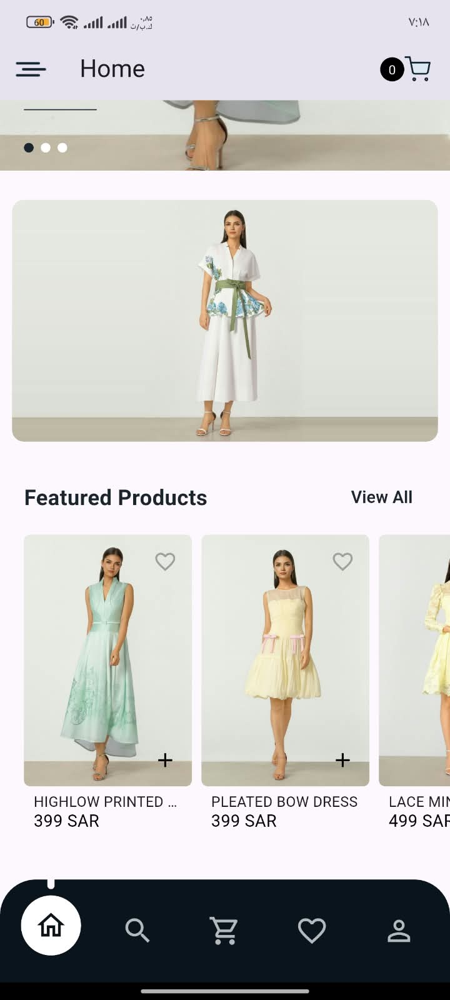
</p>

### 🛍️ Products, Sorting & Sale
<p align="center">
  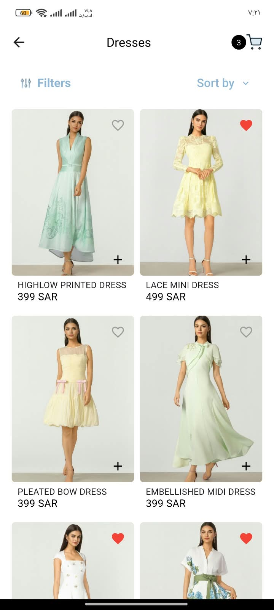
  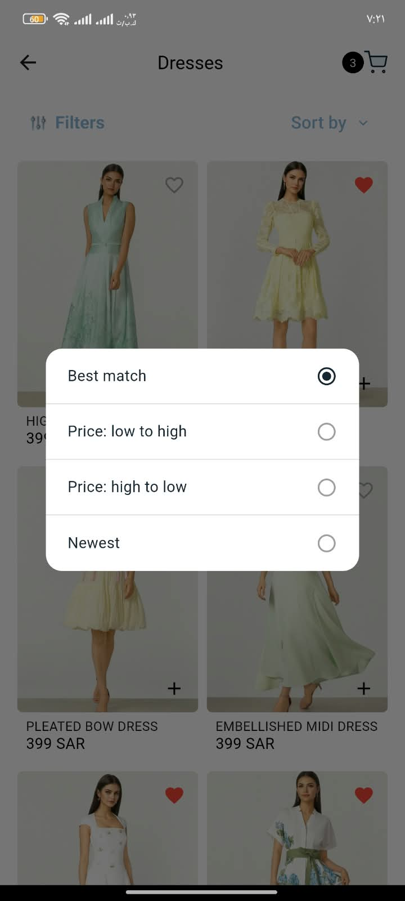
  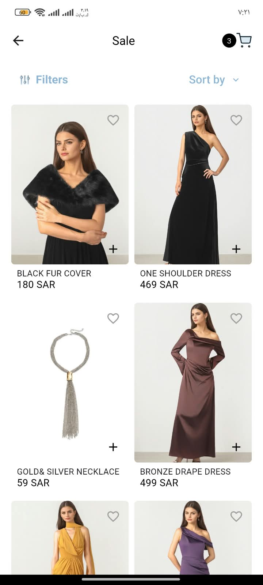
</p>

### 📦 Product Details
<p align="center">
  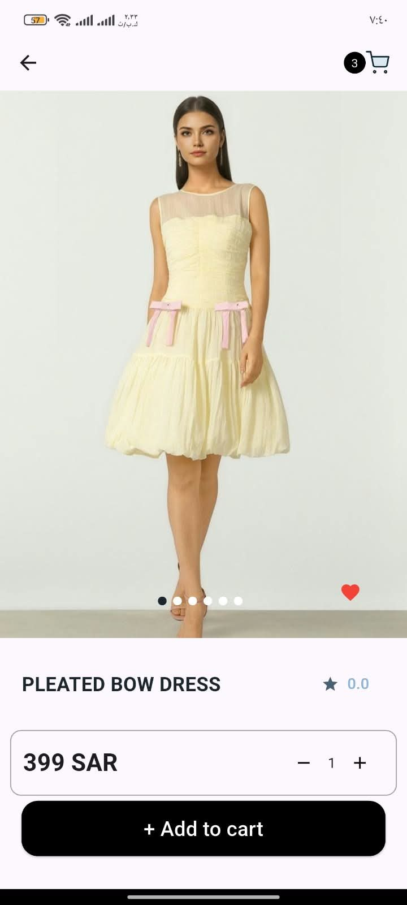
  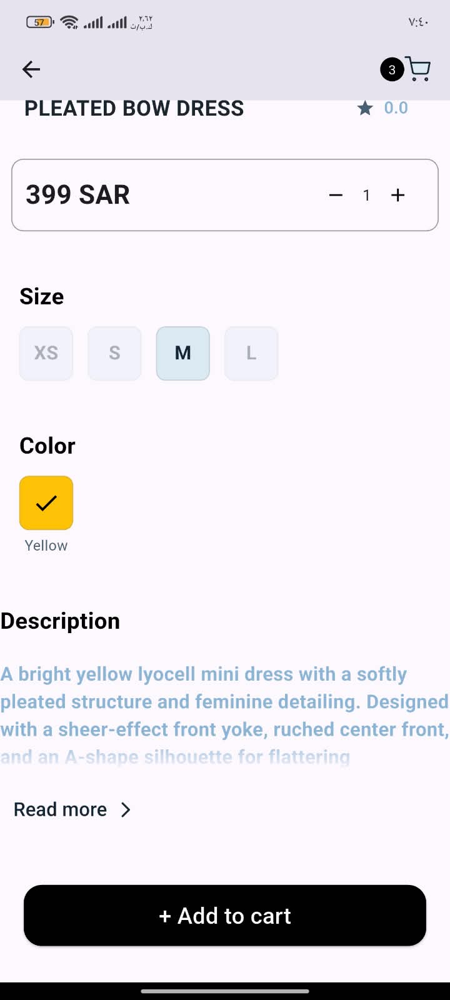
</p>

### 🛒 Cart & ❤️ Wishlist
<p align="center">
  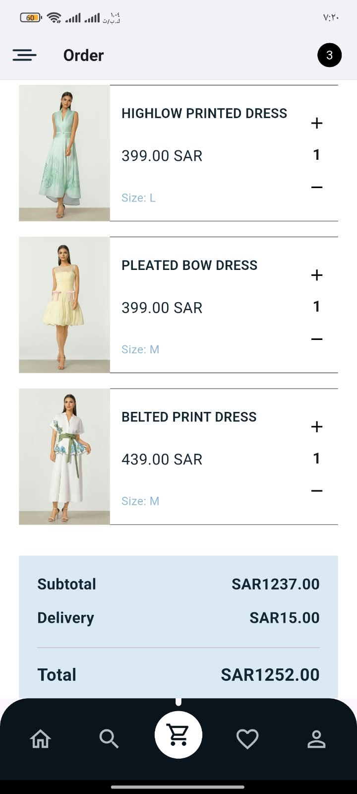
  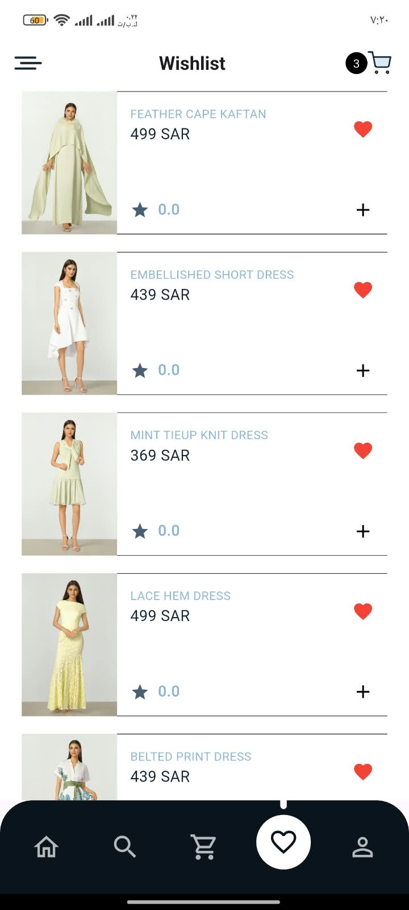
</p>

### 🔎 Search, 👤 Profile & 🧭 Drawer
<p align="center">
  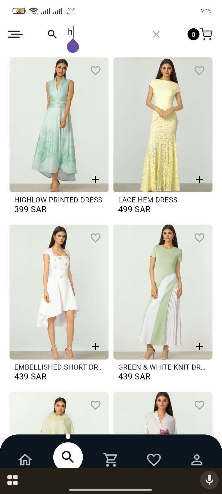
  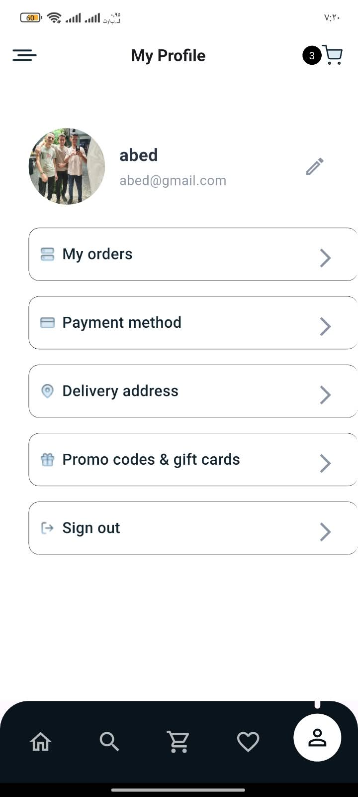
  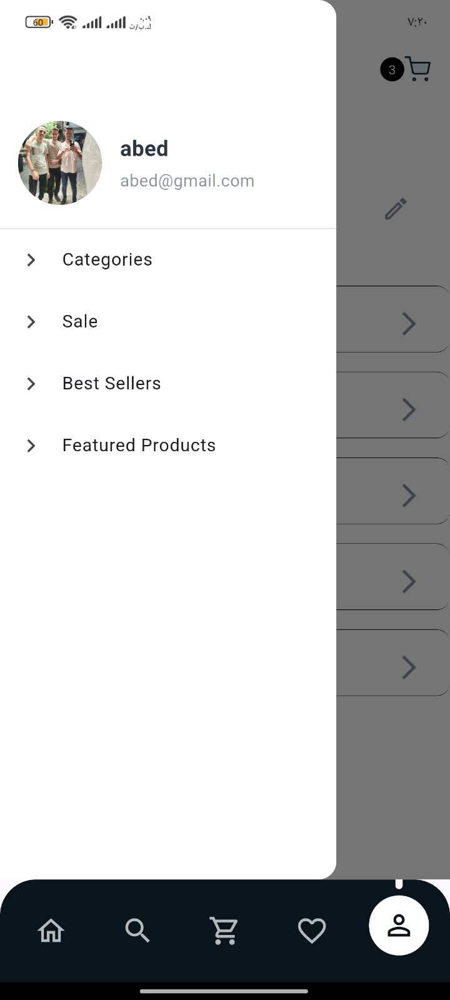
</p>

---

## 🧠 Architecture

The app uses a **feature-first** structure. Each feature is split into layers:

`Presentation (Pages / Widgets / Providers)  →  Data (Repositories / Models)  →  Core (Network / Database / Services)`

### Why this structure?
- Each feature lives in one place, so it is easy to find and change
- UI code stays separate from API and database code
- Shared code (network, theme, strings, widgets) is written once in `core`

---

## 🗂️ Folder Structure

```text
lib/
├── core/
│   ├── constants/        # AppStrings (all UI texts) + app constants
│   ├── database/         # sqflite helper + tables (cart, wishlist)
│   ├── di/               # GetIt service locator
│   ├── helpers/          # form validators
│   ├── network/          # Dio client, interceptors, endpoints, response wrapper
│   ├── services/         # preferences, secure token storage, auth events
│   ├── shared/widgets/   # ProductCard, AppDrawer, CartIconButton, UserAvatar...
│   └── theme/            # AppColors (all app colors in one place)
├── features/
│   ├── auth/             # sign in, sign up, user data
│   ├── onboarding/       # splash + onboarding
│   ├── home/             # dashboard, banners, bottom navigation
│   ├── products/         # listing, sorting, product details
│   ├── search/
│   ├── cart/
│   ├── wishlist/
│   └── profile/
└── main.dart             # app bootstrap, DI init, MultiProvider
```

---

## 🧩 State Management

State is managed with **Provider** (`ChangeNotifier`) across the whole app, with **no `setState`**:
- Global providers are registered in a single `MultiProvider` in `main.dart`
- Each provider keeps private fields, public getters and clear methods that call `notifyListeners()`
- Pages use `context.watch` to rebuild and `context.read` inside actions
- Request IDs are used to ignore outdated responses (search, category switching, sorting)

| Provider | Responsibility |
|---|---|
| `CartProvider` | Cart items, quantities and totals (memory first, then SQLite) |
| `WishlistProvider` | Saved products |
| `UserProvider` | User name, email and profile photo |
| `SignInProvider` / `SignUpProvider` | Form state and loading |
| `NavigationProvider` | Bottom navigation tabs |
| `HomeProvider` | Dashboard banners and featured products |
| `ProductsProvider` | Category products, pagination and sorting |
| `ProductDetailsProvider` | Details, size, color, quantity and gallery index |
| `SearchProvider` | Query, debounce and search results |
| `OnboardingProvider` | Onboarding slides |

---

## 🛠️ Tech Stack

| Category | Package / Tool | Usage in Project |
|---|---|---|
| Framework | `Flutter` (`Dart 3`) | Cross-platform mobile app |
| State Management | `provider` | App-wide state with `ChangeNotifier` |
| Dependency Injection | `get_it` | Repositories, database and services |
| Networking | `dio` + `pretty_dio_logger` | REST API client with interceptors and logging |
| Local Database | `sqflite` | Persistent cart and wishlist |
| Secure Storage | `flutter_secure_storage` | Encrypted auth token |
| Preferences | `shared_preferences` | User data, onboarding flag, photo path |
| Environment | `flutter_dotenv` | API base URL and keys |
| Responsive UI | `flutter_screenutil` | Sizes that scale with screen size |
| UI | `carousel_slider`, `flutter_svg` | Banners, galleries and SVG icons |
| Media | `image_picker`, `path_provider` | Profile photo from camera or gallery |
| App Icon | `flutter_launcher_icons` | Generated Android and iOS launcher icons |

---

## 🌐 API & Data Layer

- All endpoints are centralized in `core/network/api_endpoints.dart`
- An interceptor adds headers and the `Bearer` token, handles `401` responses, and turns API error statuses into readable messages
- Repositories call the API and convert JSON into models (`ProductModel`, `ProductDetailsModel`, `DashboardModel`...)
- Sorting is sent to the server (`sort` / `order`), so infinite scroll stays correctly ordered

---

## 🎨 UI & Code Quality

- **All texts** live in `AppStrings` and **all colors** in `AppColors`, so the app is ready for translation and theming
- Reusable widgets: `ProductCard`, `CartIconButton`, `UserAvatar`, `AppDrawer`, `CheckIcon`
- Graceful fallbacks: local images replace broken server images; the cart is updated in memory first for instant UI

---

## 🔐 Security Practices

- Auth token stored encrypted with `flutter_secure_storage`, with an in-memory cache for the network interceptor
- Logout clears the token, user data and the locally saved profile photo
- Environment values are kept in a `.env` file that should never be committed

---

## ⚙️ Installation

### Prerequisites
- Flutter SDK (3.x) with Dart 3.6+
- Android Studio or VS Code with the Flutter extension

### Setup
```bash
git clone <repository-url>
cd kastelli
flutter pub get
```

### Environment
Create a `.env.dev` file in the project root:
```env
BASE_URL=your_api_base_url
IMAGE_API_KEY=your_key
```

---

## ▶️ Run the App

```bash
flutter run
```

### Build
```bash
# Android APK
flutter build apk --release

# Regenerate the app icon after changing assets/icon/
dart run flutter_launcher_icons
```

---

## 🧱 Engineering Highlights

### Challenges Solved
- Moved the entire app to Provider with zero `setState`, following one consistent pattern
- Discovered and connected the API's server-side sorting so every page stays correctly ordered
- Fixed cart edge cases: memory-first updates, a minimum quantity of 1, and safe swipe-to-delete
- Kept the bottom bar visible when opening the cart from any page
- Showed full product photos (2:3) without cropping or distortion

---

## 🙏 Credits

- UI design based on the **Kastelli Figma UI Template** (Figma Community)
- Product data and images are provided by the client's backend API

---

## 👤 Author

**Abed Jaber** — Junior Flutter Developer (Freelance)

© 2026 Abed Jaber. All rights reserved.
